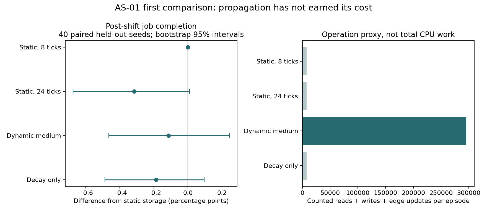

# Static storage and dynamic congestion results

The first executable comparison gives no evidence that this propagating medium improves post-shift job completion over ordinary local storage. Across 40 paired held-out seeds, the primary dynamic condition completed 91.74% of skill-eligible jobs, versus 91.85% for eight-tick static storage. The paired difference was −0.114 percentage points, with a bootstrap 95% interval of −0.465 to +0.244 points.

The result supports keeping the simpler store for this task and policy. It does not establish equivalence, falsify every dynamic medium, or evaluate consciousness.

| Condition, primary budget | Completion | Difference from B, percentage points | Bootstrap interval | Counted operation proxy per episode |
|---|---:|---:|---:|---:|
| Static store, 8 ticks | 91.85% | Reference | — | 7,366 |
| Static store, 24 ticks | 91.54% | −0.315 | −0.674 to +0.010 | 7,404 |
| Dynamic medium | 91.74% | −0.114 | −0.465 to +0.244 | 295,291 |
| Decay without propagation | 91.66% | −0.187 | −0.488 to +0.097 | 7,316 |

The secondary 24-edge-update budget gave a dynamic-minus-static difference of −0.049 points, with an interval of −0.365 to +0.247. Full diffusion slightly reduced duplicate/expired claims across episodes without improving the primary outcome. A lower collision count is therefore not sufficient evidence of useful coordination.

## What the costs mean

The operation field counts candidate congestion reads, deposits and directed edge updates. It excludes common job filtering, sorting, clipping, per-site decay/expiry and Python runtime overhead. It is a transparent workload proxy, not a total CPU-operation or energy measurement. Dynamic propagation adds exactly 288,000 counted directed updates at the primary budget. No resource-matched causal effect is claimed.

## Why this may be a poor task for diffusion

The medium carries congestion, while agents see actual feasible jobs locally. Diffusion can move a claim's effect away from the site to which the claim applies. That may blur useful specificity more than it adds anticipatory information. The fixed policy has no learned history, and the signal decays quickly. Clearing it at the replacement checkpoint consequently changes little over the later evaluation window.

This is an inference about the implementation, not a mechanism established by the endpoint alone. The next useful experiment should test a specified source of remote information value, rather than tune diffusion until the existing endpoint becomes positive. A source-aware signal that preserves where a claim belongs is a concrete comparator. Adaptive edges should be added only with a local credit-assignment rule and their own budget accounting.

## Reproduction and evidence

Run `python3 simulate.py --phase pilot` and `python3 simulate.py --phase evaluation`. The first phase uses seeds 0–9; the second uses 100–139. Each phase includes five conditions at two propagation budgets. No settings changed between the pilot and evaluation. The manifest records the executable hash, seed sets and settings. All seed-level outcomes, deterministic task hashes, summary tables and primary-budget first-seed traces are saved in the phase directories.

The inline pre-run checks verified deterministic repetition, identical paired task hashes and eligible-job denominators, zero prohibited execution, bounded field state and exact primary propagation counts. Assertions in the simulator also check skill matching and refusal at completion.

The full AS-01 A/D comparisons and the October 20 generative-participation extensions remain pending. This result is a completed bounded comparison, not a completed Active Substrates program.
