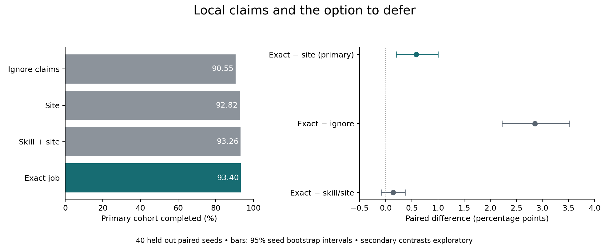

# A claim must change what an agent can choose

The separate claim-board experiment improved synthetic job completion when agents could defer work already claimed. Across forty paired held-out seeds, exact-job claims completed 93.40% of the primary cohort, compared with 90.55% when agents ignored the same records. The difference was +2.855 percentage points, with a paired bootstrap interval of +2.223 to +3.522 points.

The frozen primary contrast was narrower: exact-job claims versus blocking every candidate at a claimed site. That difference was +0.581 points, interval +0.198 to +1.002. However, exact-job claims did not establish an advantage over claims identifying the skill and site: +0.141 points, interval −0.088 to +0.372. The evidence supports avoiding broad suppression; it does not establish that exact job identity is necessary.

| Response to visible claim records | Primary completion | Mean duplicate arrivals per episode | Mean deferral decisions per episode |
|---|---:|---:|---:|
| Ignore records | 90.55% | 1,292.45 | 0 |
| Block all jobs at claimed site | 92.82% | 766.62 | 1,287.12 |
| Block matching skill at claimed site | 93.26% | 769.18 | 775.83 |
| Block exact claimed job | 93.40% | 732.20 | 733.08 |

Primary completion is the mean of forty seed-level fractions, not a pooled proportion. Arrival and deferral counts cover the whole episode and are descriptive diagnostics, not primary-cohort mediation estimates. No expired arrivals occurred. Simultaneous duplicate claims remain possible because agents act from the same pre-decision snapshot; the board only helps with claims visible from earlier decisions.

## What this changes in the research direction

The original B/C policy always chose a feasible candidate. Its field could rerank candidates but could not stop a duplicate when there was no alternative. The [design review](../DESIGN-REVIEW.md) found that more than 88% of its audited candidate decisions had only one candidate. Adding a permitted deferral response addresses that structural bottleneck.

This study separately changes the encoding and action rule from the first study. Its clean comparisons are between its own four conditions. It does not show that it outperforms the original B/C at matched resources, that diffusion is harmful, or that remote information is useful. It contains no remote-demand channel, addressed messages, adaptive conductances or learning.

The results make a simpler local skill-and-site board a credible comparator for future A/D work. Increasing representational detail beyond that has not yet earned a clear endpoint gain. Future dynamic-medium comparisons should hold the agent's available actions constant, charge additional state and propagation, and identify what information the medium supplies beyond these records.

## Workload accounting

| Response | Record reads | Record writes | Candidate scans | Candidate–record comparisons |
|---|---:|---:|---:|---:|
| Ignore | 29,137.53 | 3,451.62 | 145,413.15 | 5,976.80 |
| Site | 25,667.33 | 2,985.43 | 144,055.12 | 6,139.43 |
| Skill and site | 25,692.67 | 2,998.97 | 137,815.20 | 5,475.90 |
| Exact job | 25,624.70 | 2,961.43 | 137,681.75 | 5,335.95 |

These are per-episode means. The five-field records occupy at most twelve slots (60 semantic scalar fields); identifiers are Python integers, not a fixed bit width. Scalar read/write counts multiply records by five. Actual paths and workload differ despite equal schemas and access permissions.

**Accounting clarification:** the frozen specification says each decision “scans twelve possible board slots.” The implementation uses a sparse dictionary, while `board_slot_checks` charges the full twelve-slot capacity per idle decision and maintenance tick. That field is a capacity-based accounting allowance, not the actual count of dictionary iterations. The recorded read, write, scan and comparison counters above count the stated executed events. No total-runtime, total-instruction, energy or equal-compute claim should be made. This discrepancy does not affect choices or the endpoint; the frozen code and specification are retained with this correction rather than silently rewritten.

The inherited output name `replacement_rate` denotes completion for births in ticks 2400–2899 only. There is no replacement intervention in this study. It is not evidence about succession.

## Verification and retained evidence

Four tests passed before freezing: semantic specificity, simultaneous-claim limits, paired task/refusal checks and a later-visible-claim fixture. During test construction the last fixture initially failed because its exploration seed moved the agent away from the job; the fixture seed was corrected before any pilot run. The implementation did not change in response to pilot outcomes.

Ten pilot seeds (200–209) and forty evaluation seeds (1000–1039) produced 40 and 160 retained rows. All paired task hashes and skill-eligible denominators match. Execution assertions enforce skill and refusal; checks also verify that the refusing skill-zero agent completes no jobs. Duplicate/expired accounting reconciles, exact-job first-seed repetition is deterministic, and the frozen source/specification hashes match in both phases. All original first-study executable and run files match their pre-review checksums.

The primary interval uses 5,000 paired seed-bootstrap resamples. Secondary intervals are exploratory and unadjusted for multiple comparisons. These synthetic trials quantify this fixed generator and policy; they are not human, biological or deployment validation.

Files: [specification](SPECIFICATION.md), [frozen hashes](freeze.json), [study implementation](study.py), [runner](run.py), [tests](test_study.py), [evaluation summary](evaluation/summary.json), [all evaluation rows](evaluation/all-seeds.json), [pilot summary](pilot/summary.json). First-seed traces for every condition are retained in each phase directory. The original local PDF figure is omitted from this release; the evaluation data and report above are retained.

Reproduction requires a fresh copy of the source tree with the imported `../simulate.py` preserved and without prior freeze or run outputs. Run `python3 -m unittest discover -v`, then `python3 run.py freeze`, `python3 run.py pilot`, and `python3 run.py evaluation`. The runner refuses existing output directories and refuses changes to frozen executable dependencies or specification. Do not delete the first results to rerun them.
