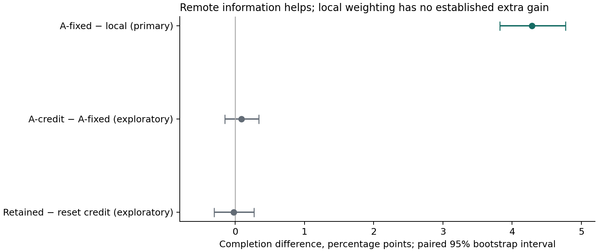

# Remote information finds more work—and sends agents to stale work

Addressed observations improved completion in the frozen synthetic environment. They did so at a substantial travel and messaging cost. Recipient-local success weighting did not establish a further completion benefit, and retaining that learned table through the reset did not establish a benefit over clearing it.

This completes an addressed-message A extension and a recipient-local credit mechanism. It does **not** complete adaptive-substrate D or establish that messages outperform a spatial medium under matched total resources.

## Held-out results

Forty paired evaluation seeds (4000–4039), four conditions, 160 episodes; ten separate pilot seeds (3000–3009), 40 episodes. No settings changed after the specification and executable hashes were frozen. Each episode lasts 3,000 ticks. The primary window concerns skill-eligible jobs born at ticks 1000–1499; the later window covers births at 2400–2899.

| Condition | Primary completion | Later-window completion | Total completed jobs | Travel units | Wasted travel | Message payload scalars |
|---|---:|---:|---:|---:|---:|---:|
| Local skill-and-site board | 94.08% | 92.00% | 2,223.6 | 8,683.7 | 1,095.1 | 0 |
| A-fixed addressed reports | 98.36% | 97.59% | 2,342.8 | 12,276.4 | 4,795.9 | 90,425.4 |
| A-credit local outcome weighting | 98.46% | 97.59% | 2,344.0 | 12,299.8 | 4,807.4 | 90,311.0 |
| A-credit-reset | 98.46% | 97.61% | 2,343.8 | 12,305.6 | 4,807.8 | 90,271.4 |

Values are seed means. Payload counts exclude the common claim board; its reads/writes and other logical operations are retained separately in the raw results.

| Contrast | Mean difference | Paired 95% bootstrap interval |
|---|---:|---:|
| **Primary:** A-fixed minus local, primary window | **+4.288 percentage points** | **+3.823 to +4.769** |
| Exploratory: A-credit minus A-fixed, primary window | +0.091 points | −0.151 to +0.341 |
| Exploratory: A-credit minus A-credit-reset, later window | −0.020 points | −0.306 to +0.274 |

Intervals use the frozen 10,000 seed-level paired resamples and analysis seed 73021. Secondary intervals are not adjusted for multiple comparisons. The near-zero secondary estimates are not equivalence tests.

## What the additional completion costs

A-fixed completes about 119.2 additional jobs per episode while traveling 3,592.8 additional units: about 30 additional travel units per additional completion as a descriptive ratio of aggregate means. Total travel rises 41.4%; wasted travel rises to 4.38 times the local control. Failed arrivals rise from 752.9 to 1,685.9 per episode. These are not a calibrated energy or financial cost function; whether the trade is worthwhile depends on the value of timely completion and the price of travel and communication.

The simulator deliberately does not give receivers a global completion oracle. A report says that a sender observed a job, not that it will still be available after travel. Remote reports remain actionable until their TTL or deadline expires; work already completed outside local visibility is discovered on arrival. The tests construct precisely this failure. A-fixed makes about 1,448 remote commitments and 491 successful remote completions per episode; some commitments remain in flight at the horizon, so the ratio is not an exact completed-attempt success rate.

All three messaging conditions have the same four-packet/32-scalar per-tick cap and eight-entry per-recipient mailbox. Realized traffic differs, and the local control sends none. Adaptive conditions also retain approximately 121 sender/recipient credit cells at peak on average, each with two integer counters. No claim of matched CPU, memory, energy or wall time follows from the shared communication cap. The environment's task and completion ledgers remain simulator machinery; they are not exposed as remote receiver knowledge.

## Why the local learning result is limited

The recipient updates a sender's score only when it arrives at a job learned from that sender. No global reward or hidden task state trains the score. But the score only ranks candidates: it cannot refuse the sole feasible candidate because its weight stays positive. This makes the experiment a test of ranking by local outcomes, not of learning when to abstain.

A clearly labeled post-hoc diagnostic of retained seed 4000 found 1,854 decisions with a remote option. Of these, 1,381 (74.5%) had only one candidate. Local weighting changed the selected job versus the fixed-weight ranking in 33 decisions (1.8%). The instrumented trajectory matches every original result field. This single-trajectory diagnostic explains a restricted opportunity for the mechanism to act; it is not an additional population estimate or a causal decomposition of the null result.

The conclusion is therefore narrower than “local learning does not help.” This particular positive-weight ranking mechanism showed no established advantage in this environment. A useful next experiment would freeze an explicit abstention/verification policy with a meaningful cost for waiting and compare it against the addressed baseline. Adaptive-substrate D would additionally need an actual spatial update rule, local credit assignment to that rule, and resource accounting comparable to messaging. Renaming the current credit table would not supply that experiment.

## Verification and retained evidence

Seven tests pass: delayed remote commitment and stale failure; bounded mailbox eviction; TTL/deadline boundaries; local-outcome-only credit updates; refusal and packet caps; identical pre-reset trajectories; and exact agreement of the local control with the preceding skill-and-site implementation on a new seed. All 160 evaluation rows have paired task hashes and eligibility denominators. No prohibited execution occurred. The A-credit and A-credit-reset primary results agree on every seed, as required by their identical pre-reset policies.

All fifty preexisting non-cache experiment files were verified against hashes before and after both phases. The first B/C experiment and the claim-specificity experiment were not overwritten. Specification/code hashes are unchanged across pilot and evaluation. The post-hoc audit is separate and did not change the frozen study.

- [Frozen specification](SPECIFICATION.md) and [freeze manifest](freeze.json)
- [Evaluation rows](evaluation/rows.json) and [summary with intervals](evaluation/summary.json)
- [Pilot rows](pilot/rows.json)
- [Post-hoc credit-opportunity audit](credit-opportunity-audit.json) and [audit script](audit_credit.py)

`run.py` refuses an existing phase directory. `audit_credit.py` refuses to overwrite its retained diagnostic. To reproduce, copy the study directory and the unchanged parent `simulate.py` and `claim-specificity/study.py` into a fresh matching tree, omit generated phase folders and the old freeze manifest, then run tests, freeze, pilot and evaluation. No private data or model API is involved.
